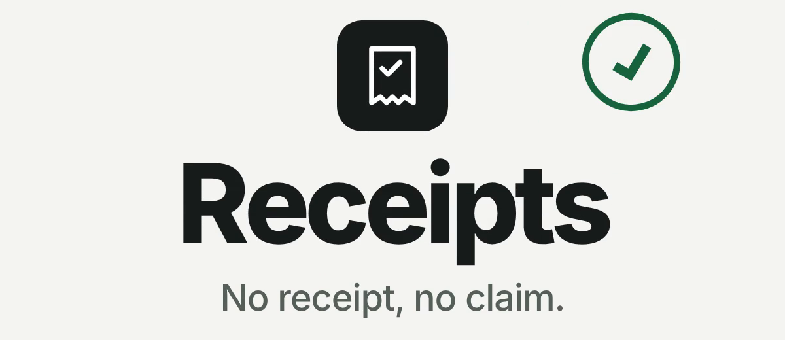

# Receipts: no receipt, no claim

[](docs/demo/receipts-demo-final.mp4)
*(click the image to watch the 104-second demo, recorded from the running app)*

**Receipts checks an AI-written company briefing against the live web and keeps only the claims that can show a receipt: a real source, and a quote that actually appears in it.** Built for the Imperial AI Hackathon (14-15 Nov 2026).

**Track:** Autonomous Agents (main track) · **Bounty:** Best use of Linkup — an agent built around Linkup live web search that researches, verifies and cites its sources · **Extra prize:** Best-Designed AI Product (Figma) — design evidence in [`docs/figma/`](docs/figma/).

> AI briefings do not fail loudly; they fail confidently.

## The problem is already public

Deloitte Australia refunded part of a government contract after an AI-written report cited research that doesn't exist ([AP News](https://apnews.com/article/australia-ai-errors-deloitte-ab54858680ffc4ae6555b31c8fb987f3)). EY withdrew a study after researchers found AI hallucinations in it ([AFR](https://www.afr.com/world/north-america/ey-retracts-study-after-researchers-discover-ai-hallucinations-20260517-p5zxss)). KPMG pulled an AI report after only 5 of its 45 citations matched real sources ([The Register](https://www.theregister.com/ai-and-ml/2026/06/12/kpmgs-ai-report-turns-into-a-demo-of-ai-hallucinations/5255029)). These are press reports, not our findings — but they're the same failure every time: confident text, nothing behind it. Asking the same model to check itself doesn't help either; it grades its own homework.

## What it does

1. **Input:** paste a briefing, or give a company name and the model drafts one from memory (no web access, on purpose, so the draft can be wrong).
2. **Extract:** up to 20 atomic factual claims, ranked by impact — numbers and dates first. The top 8 are checked per run.
3. **Research each claim** live with [Linkup](https://www.linkup.so): plan a search query, search the web, ask the model to *propose* a source and a verbatim quote. One reworded retry if the first search finds nothing.
4. **A referee in plain code decides — the model never does.** `referee.py` can only *lower* a verdict, never raise one. A claim is kept only if the source is one of the search's own results, the quote really appears in it, the claim's numbers and dates appear in the quote, and the quote isn't a rumour, a plan, or a denial.
5. **Policy:** supported claims get footnotes; contradicted claims are struck through with the contradicting source; plans are labelled as plans; everything else is "Needs your check" with a manual-search link — never a guess.
6. **Rewrite:** the model writes the final briefing from receipted claims only, and code re-checks every number and date in every paragraph against the cited quotes before it ships.
7. **Attack mode:** type any single claim — not just from a briefing — and it runs the same search-judge-referee pipeline live, on camera, in the demo.

**The one sentence that matters:** the AI proposes, code decides. This is a visible, budget-capped agent loop (plan → search → retry → judge → referee → rewrite), not an open-ended agent, and it never writes or runs code.

## Why this is more than a prompt wrapper

- **The safety check is code, not a prompt.** `referee.py`'s rules (R0-R9) are deterministic Python. The LLM's "reason" is shown in the UI explicitly labelled *not trusted on its own*.
- **A real evaluation, not a demo-only showcase.** 32 claims across 4 companies, hand-labelled blind (before seeing any verdict), scored by `eval/score.py` — see [Evidence](#evidence-every-number-traces-to-a-committed-file) below. Most hackathon projects show zero measurement; this one shows its working, including where it falls short.
- **It knows when it's lying to a cache, not the internet.** Every run shows a live/offline badge per API (from a real health-check call) and a "Live run / Partly replayed / Replayed from saved results" badge with exact counts — so a judge watching the demo can tell what's real.
- **88 automated tests** (`pytest`, no network, no keys) plus a **real headless-browser end-to-end test** (`tests/e2e_browser.mjs`) that drives the actual running app: sample run, evidence drawer, rewrite, diff, attack mode, and a phone-width layout.
- **Every capability claim in this README traces to a file and line** — see [Claims traced to code](#claims-traced-to-code). Nothing here is asserted without a pointer to the code that makes it true.
- **A call budget is enforced and shown on screen**, not just mentioned: a run that would exceed it stops and says so.

## Evidence (every number traces to a committed file)

First real-data checkpoint, `eval/results.json`: 4 companies (OpenAI, Databricks, Anthropic, Mistral AI), 8 claims each, 32 claims.

| Result | Value | Source file |
|---|---|---|
| Claims checked | 32 | `eval/results.json` |
| Supported / contradicted / plans / needs your check | 13 / 0 / 0 / 19 | `eval/results.json` |
| Times the judge proposed "supported" | 43 | `eval/results.json` |
| Kept by the referee / lowered by the referee | 13 / 30 (R8: 18, R2: 7, R7: 4, R1: 1) | `eval/results.json` |

Two later trials on the same 32 claims after referee fixes (`eval/results_fix1.json`, `eval/results_fix2.json`): supported 19 and 14. The spread comes from the models, not the rules (the SDK exposes no temperature setting) — **a single number here is noisy; the method is the point.**

**Hand labels (`eval/label_sheet.csv`), scored by `eval/score.py`.** All 32 claims were labelled true/false/unknowable by hand *before* seeing any Receipts verdict, and every one came out true. That's a real limit of this label set, not a brag: with no false claims in the sample, **the false-positive rate can't be measured here** — there's no case where the referee should have caught a fabrication and did or didn't. What the labels do show: of the 32 true claims, the referee kept a receipt for 13 (41%) and sent the other 19 to "needs your check." Nothing was wrongly contradicted, because nothing was contradicted in this run. **No accuracy figure is claimed.** Measuring precision needs claims that are actually false — see [Honest limits](#honest-limits).

## How to run

Requires Python 3.11 and two API keys (never commit them).

```powershell
python -m venv .venv
.venv\Scripts\python.exe -m pip install -r requirements.txt
# create .env (git-ignored) with:
#   ANTHROPIC_API_KEY=...
#   LINKUP_API_KEY=...
.venv\Scripts\python.exe app.py                  # web app on http://127.0.0.1:8765
.venv\Scripts\python.exe agent.py "Databricks"   # same loop in the terminal
.venv\Scripts\python.exe -m pytest -q            # 88 tests, no network, no keys
node tests\e2e_browser.mjs                       # real headless-Edge test of the running app
```

**Saved results and fresh runs.** Searches and validated model replies are saved on disk (`cache/`, git-ignored), so a rehearsed run replays exactly and quickly — the UI says so honestly, with exact counts in the badge tooltip. Tick "Fresh run" (or pass `--fresh`) to ask the models again; searches stay cached to save Linkup credits. Every Linkup search is cached, so repeat runs cost no search credits, and the app binds `127.0.0.1:8765` exclusively so a stale second copy can't silently share the port.

## APIs, models and datasets used

| What | Use |
|---|---|
| Anthropic Claude Haiku 5.5 (`claude-haiku-5-5`) | extract claims, plan and reword search queries |
| Anthropic Claude Sonnet 5.5 (`claude-sonnet-5-5`) | memory-only draft, judge (proposes verdict, source and quote), rewrite |
| Linkup search API (`linkup-sdk` 0.24.1) | live web search, `searchResults` output |
| FastAPI 0.162.7, uvicorn 0.54.0, starlette 1.10.0, pydantic 2.14.3, anthropic 2.8.0, httpx 0.28.1, pytest 9.2.0 | app, validation, SDKs, tests (all pinned in `requirements.txt`) |
| Figma Make | UI design exploration; evidence in `docs/figma/` |
| ElevenLabs text-to-speech, Hyperframes (HeyGen) | narration and composition for the demo video only — not part of the app |
| Music: "Happy Beats / Business Moves" Vol. 1 by Sascha Ende, [ende.app](https://ende.app/en) ([CC BY 4.0](https://ende.app/en/standard-license)) | demo video soundtrack only |
| Datasets | none. Evaluation uses whatever the live web returns for each query. |

## Honest limits

- The referee is conservative: it drops true claims that have hedge words in the quote's clause (`reportedly`, `likely`, `will`), numbers the quote doesn't repeat, or a quote that doesn't share enough words with the claim. Measured above as the kept/lowered counts and the 41% recall.
- Its false-positive rate — whether it would catch a fabricated claim — is not yet measured. Every hand-labelled claim here is true; a false-claim benchmark is the obvious next step, not yet built.
- A quote can still hide a hedge outside its clause. R2 doesn't check units beyond scale suffixes (million, billion, %).
- "Contradicted" means a source says something different; the referee doesn't check both statements cover the same time period (an older source is labelled "older source, may be stale").
- The referee doesn't judge how authoritative a source is. Some receipts come from low-quality sites.
- Linkup only returns what it finds. `published_at` is missing on about half of results, so freshness is "recent", "older source, may be stale" or "date unknown" — a freshness check, not date verification.
- The rewrite check (R9) blocks invented numbers and dates; it doesn't prove the prose adds no other unverified statement.
- The audit log (`audit.jsonl`, git-ignored) is a plain log, not tamper-proof.
- The sample briefing is written for the demo with facts deliberately out of date, and is labelled as a sample everywhere it's shown — it is not a real AI draft.

## Claims traced to code

Line numbers are as of the commit that added this file.

| Claim | Where |
|---|---|
| The model cannot invent a source: the URL must be a returned result and the quote must appear in it (R1) | `referee.py:284`, `referee.py:286`, `quote_in_content` at `referee.py:108` |
| The referee can only lower a verdict, never raise one | `decide` at `referee.py:256` (every failure path returns "unverified") |
| Numbers and dates in a supported claim must appear in the quote (R2) | `referee.py:308-311`, `_missing_specifics` at `referee.py:221` |
| Hedged or denied quotes do not support a fact; claims about plans are labelled (R7) | `referee.py:319`, `referee.py:323`, `referee.py:326` |
| A failed search becomes "unverified", never a guess (R6) | `referee.py:274` |
| Claim relevance is checked (R8) | `referee.py:290`, `referee.py:304` |
| Every number and date in a rewritten paragraph comes from a cited quote (R9) | `check_paragraph` at `referee.py:340`, called for every paragraph at `rewrite.py:52` |
| Call budget enforced and visible | `Budget` at `referee.py:369`, `Meter` at `agent.py:104`, R4 at `agent.py:246` |
| Search results are treated as data, not instructions | `llm.py:235` |
| Searches are cached; a cache hit costs no budget | `search.py:103` |
| Freshness label from the source's own `published_at` | `agent.py:159` |
| Every run is appended to `audit.jsonl` | `_write_audit` at `agent.py:427` |
| One server on the port; a stale second copy cannot share it | `app.py:225` |
| Live/offline status comes from a real API call | `health` at `app.py:87` |

## Layout

```
app.py       FastAPI app, server-sent events, health and attack endpoints
agent.py     the loop: rank, plan, search, judge, referee, retry, freshness, audit log
referee.py   plain-code rules R0-R9 and the call budget
rewrite.py   rewrite step, footnotes, draft-versus-verified diff
llm.py       Anthropic wrappers (Haiku 5.5, Sonnet 5.5)
search.py    Linkup wrapper with disk cache
static/      plain HTML, CSS and JS (no build step)
eval/        checkpoint runs, label sheet, scoring, disclosed trials
docs/figma/  design evidence · docs/demo/ demo video · docs/shots/ before/after UI
tests/       tests (no network)
```

---

Built during the Imperial AI Hackathon weekend (14-15 Nov 2026) with Claude as a coding assistant; the commit history shows when. No code from earlier projects was reused. Design explored in Figma Make — `docs/figma/FIGMA-EVIDENCE.md` says exactly what was and wasn't done.
